# Trip AI

**An AI travel planner that packs for the weather.** Tell it who is going, where, how you like
to travel and what you care about. Claude writes a titled itinerary, five tours for the city,
a tip and a packing list counted for your days. When you are leaving soon, the real forecast
for the destination sets the dates and the packing list.

**Live:** https://trip-ai-world.vercel.app

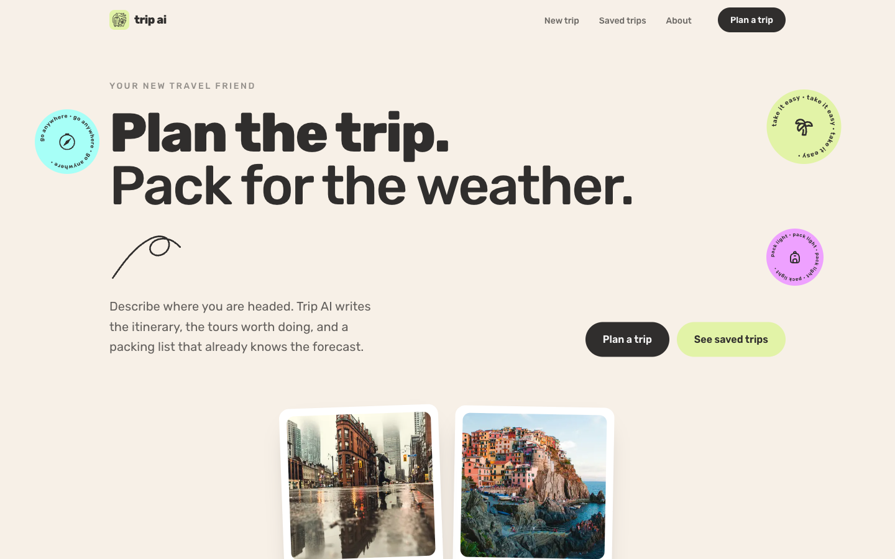

Next.js 16 · React 19 · TypeScript · Claude Sonnet 5.5 (Anthropic API, strict tool use) ·
Postgres + Prisma · Tailwind CSS v4 · Vitest + Playwright · Vercel

---

## Highlights

- **The prompt never leaves the server.** The browser sends a typed `TripRequest` as JSON. The
  server validates it with Zod, resolves the city with GeoNames, fetches the forecast at those
  coordinates, builds the prompt and calls Claude. A client cannot spend the API key on a
  prompt of its own.
- **Structured output that is checked twice.** Claude answers through a `strict: true`
  `submit_trip` tool. Its input is parsed again with Zod before anything is saved. A refusal,
  a `max_tokens` stop or an invalid trip fails loudly instead of saving half a trip.
- **Weather-grounded.** With "Plan around the weather" on, the server fetches the 5-day
  forecast at GeoNames' coordinates. It keeps one reading per trip day, the one nearest midday
  in the destination's time, and gives those readings to the model. The packing list and the
  tours follow them.
- **Generation can be cancelled, and it keeps running if you leave the page.** A trip takes
  about a minute. It runs in an app-wide store, so you can leave the form and a toast offers
  the trip when it lands. Cancel aborts the `fetch`, and the abort reaches the server, which
  stops the Claude call and writes nothing.
- **A refresh keeps your trip.** Every generated trip is written to Postgres under an
  unguessable URL and rendered on the server. Keeping or discarding it only changes a flag.
- **Tested.** 1,100+ unit tests (Vitest + React Testing Library) and 80+ Playwright tests
  against a production build. CI runs the type check, the build, the unit tests and the e2e
  tests on every PR without secrets: the external APIs answer from fixtures there.
- **One design system.** *Sorbet* is pastel on cream, with polaroids, stickers and handwritten
  captions. It is built CSS-first on Tailwind v4, uses HeroUI for accessible primitives and
  respects `prefers-reduced-motion`.

## Screenshots

A real saved trip: a five-day celebration in Athens, planned around the forecast.

<p>
  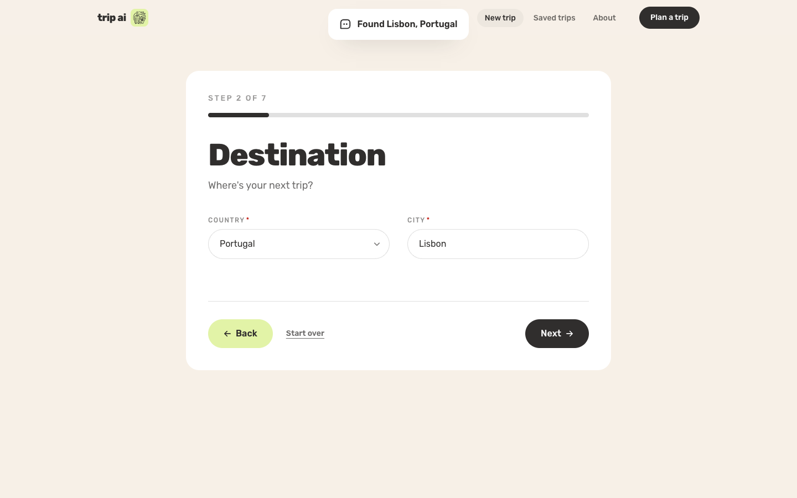
  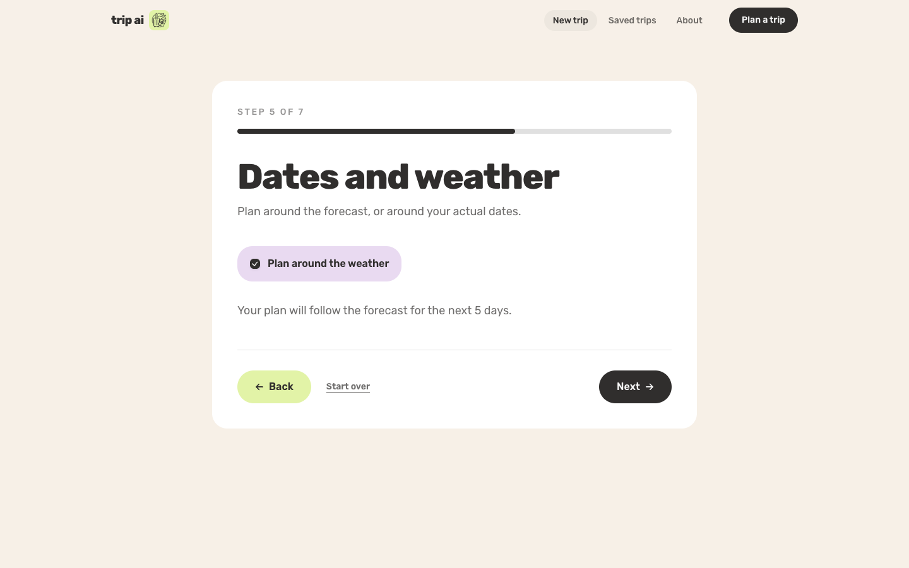
</p>

<p>
  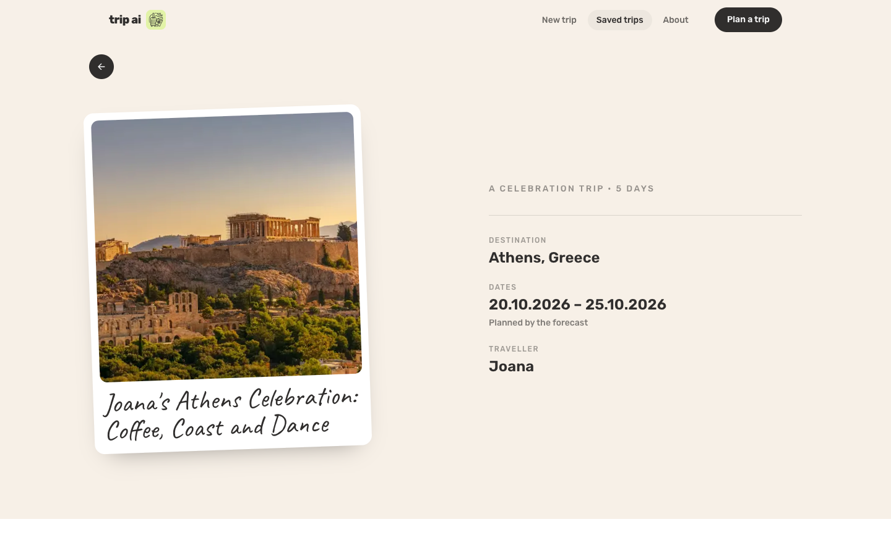
  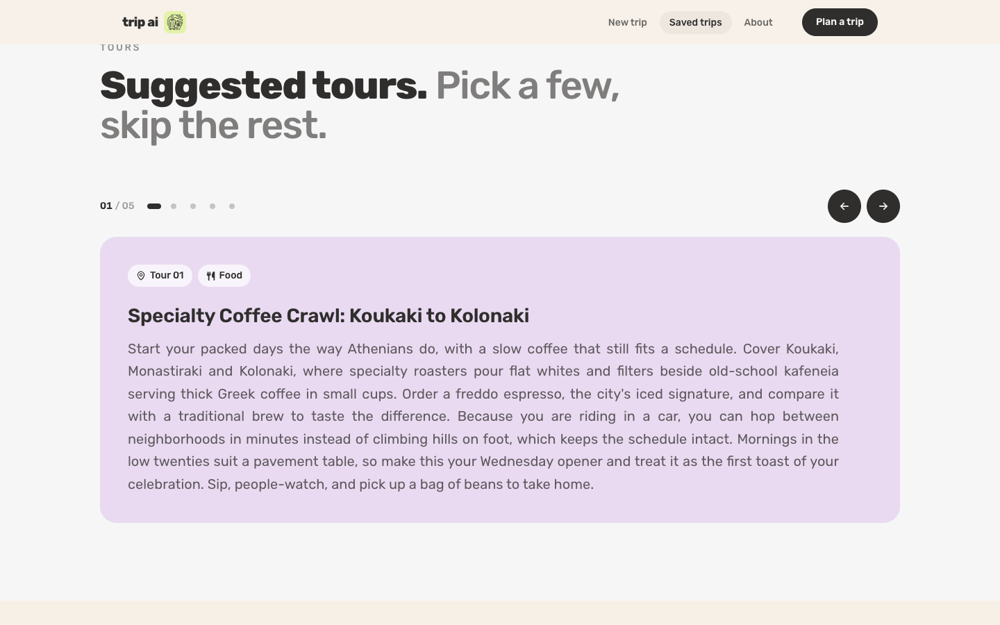
</p>

<p>
  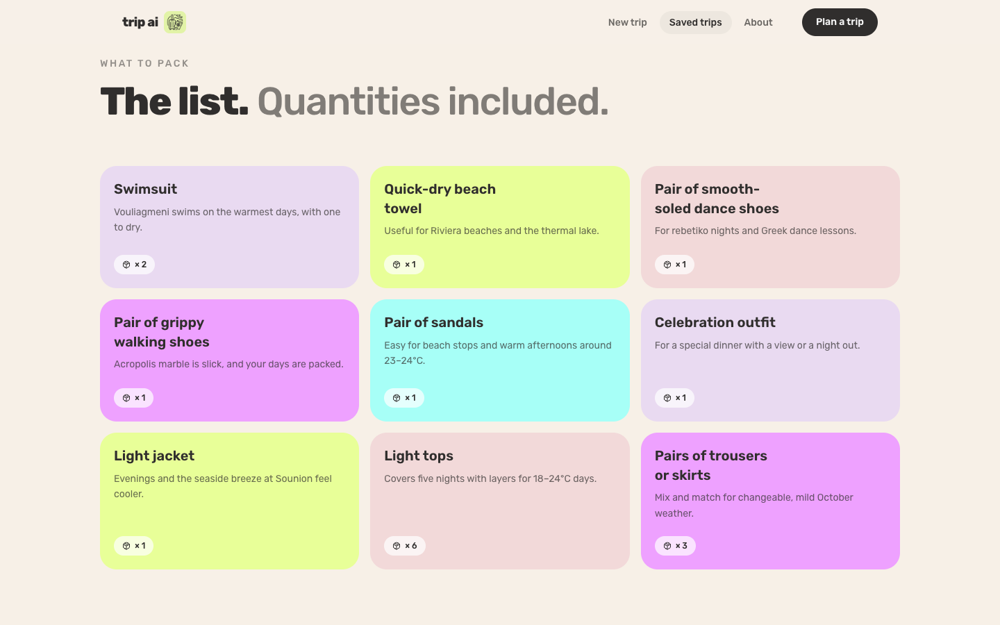
  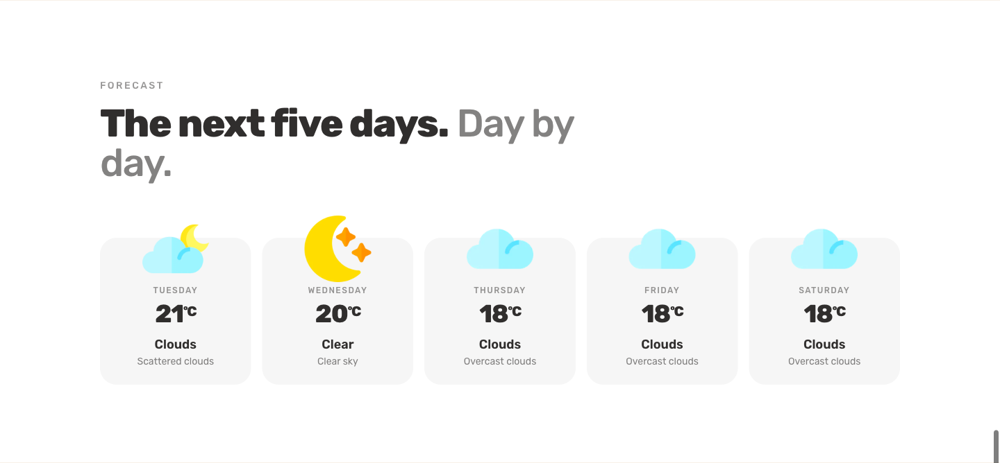
</p>

<p>
  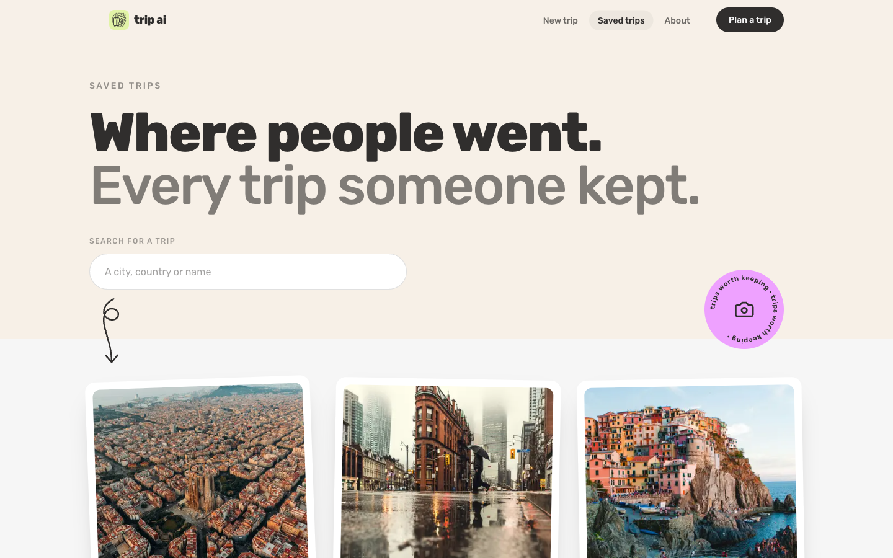
</p>

### On a phone

<p>
  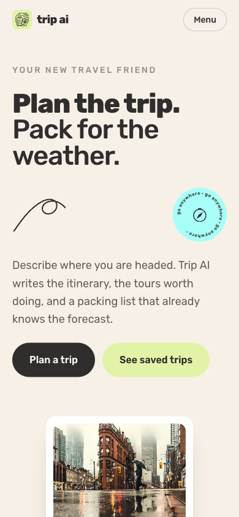
  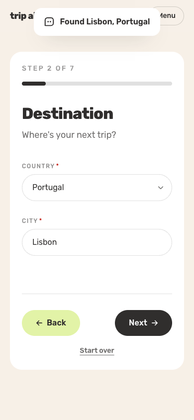
  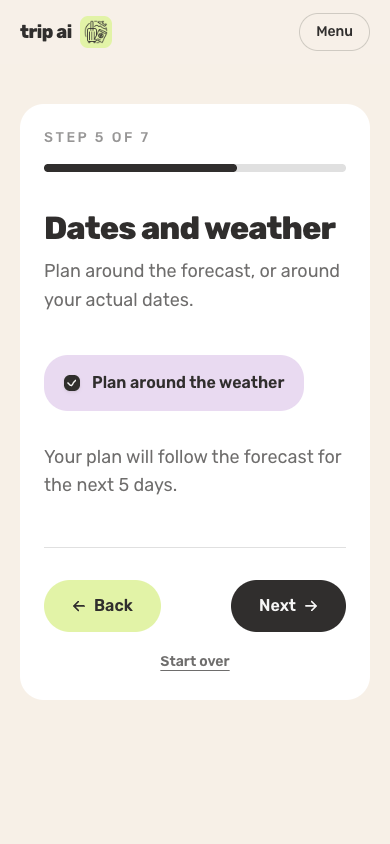
  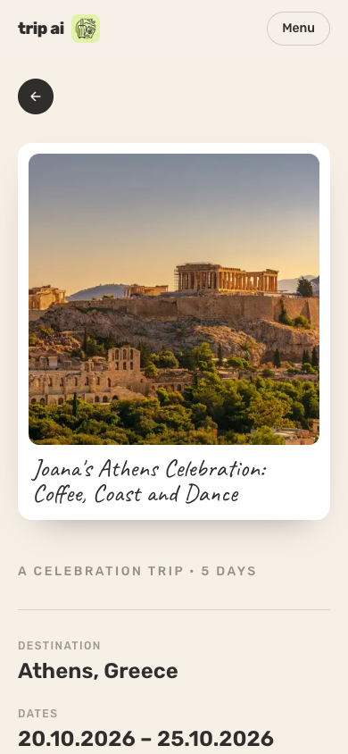
</p>

<p>
  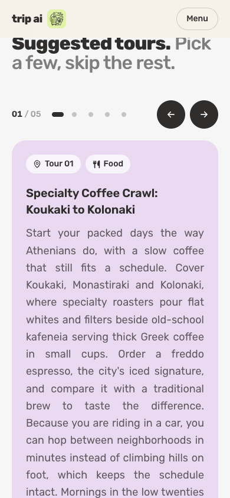
  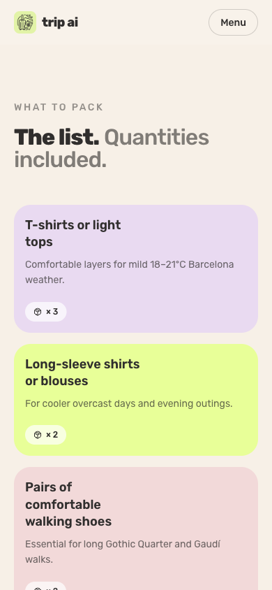
  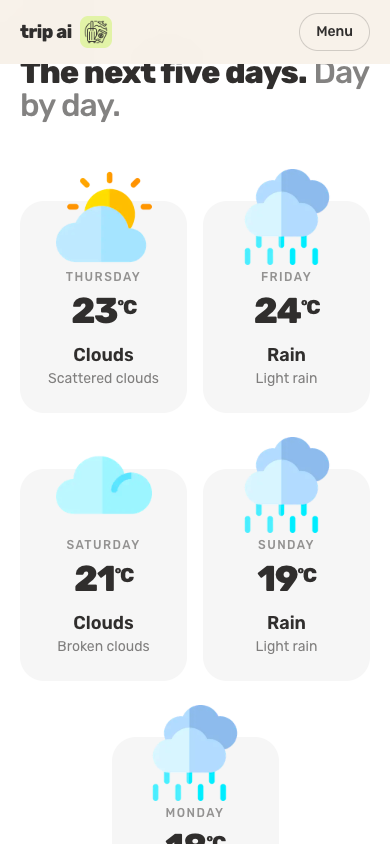
  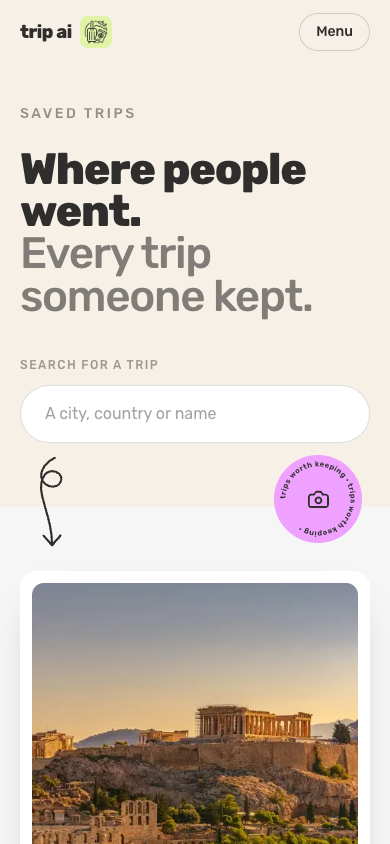
</p>

## How it works

1. **The form** (`/form`) has seven steps: who is going and their ages, the destination,
   the kind of trip, things you must bring, the dates (or "plan around the weather"), up to
   three interests, and a review. The city is checked against GeoNames as you type. A draft
   is saved in the browser, so a reload keeps your answers.
2. **The generation** starts with `POST /api/trip`. The server validates the request, resolves
   the place, fetches the forecast and the Unsplash photos, and calls Claude. It writes the trip
   unsaved and returns its URL. The loader runs meanwhile, and Cancel stops the work on the
   server.
3. **The trip** (`/trips/[tripUrl]`) is a server-rendered page: a polaroid, a description,
   five tours (each tagged with a kind), the packing list, essentials, current weather and the
   forecast, and what you told it. You decide whether to keep it.
4. **Saved trips** (`/saved-trips`) is a wall of polaroids, searchable by city, country or name.
   The landing page shows the three newest.

## Architecture

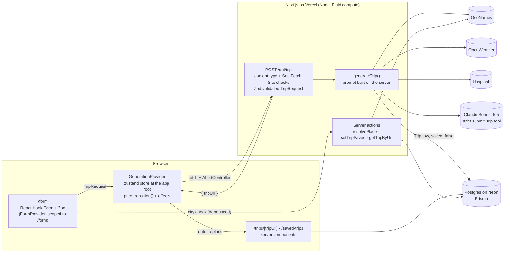

- **The server owns the trip.** `generateTrip` (`src/app/api/anthropicApi.ts`) re-validates
  the request (`src/lib/agent/request.ts`) and resolves the city again. It builds the prompt
  (`src/lib/agent/prompt.ts`) and calls Claude, streamed, with the strict `submit_trip` tool
  (`src/lib/agent/submitTrip.ts`). The photos are fetched alongside the model call. The row is
  built from the request, the resolved place and the model's output (`src/lib/tripRow.ts`),
  never from anything the client sends about the trip.
- **The generation is a state machine.** Its whole state is one value, changed only by a pure
  `transition(state, action)` (`src/lib/generation.ts`). Each transition returns its effects
  (abort the request, clear the draft, open the trip, show a toast) and the provider runs them.
  The toasts and the loader are derived from that state. A table-driven test asserts every
  action from every state.
- **The form is scoped to `/form`.** `FormProvider` lives in `src/app/form/layout.tsx` and is
  split into three memoised contexts (steps, fields, city check), so typing in the city
  re-renders only its readers. Only the generation lives at the app root.
- **Pages read from the server.** The trip pages and the saved-trips wall are server
  components reading Prisma. The weather sections take their promises with React's `use()`,
  each inside its own `<Suspense>`, so the trip renders before the weather arrives.
- **External APIs are behind server-only modules.** GeoNames, OpenWeather and Unsplash are
  called from the server only, with their keys there too. OpenWeather is queried at the
  coordinates GeoNames resolved, not geocoded again by name.

## Decisions worth explaining

| Decision | Why |
|---|---|
| **A route handler, not a server action, for generation** | Next runs server actions one at a time per client. A cancelled minute-long action would hold the next city check until it finished. A `fetch` can be aborted, and the abort reaches the server through `request.signal`. |
| **`strict: true` tool with `tool_choice: auto`** | Sonnet 5.5 rejects a forced `tool_choice`. A strict tool still gives schema-shaped input, and Zod checks it again because one production response sent the tours as a JSON string. |
| **Write the trip before the traveller sees it** | A refresh, a shared link or a closed tab keeps the trip. "Save" flips a flag on a row the server wrote, so the client can never write an arbitrary trip. |
| **The form sends a choice, not data** | The request says `byWeather: true` and the server fetches the forecast. The browser has no route to OpenWeather, and the prompt sees one midday reading per day instead of 40 noisy three-hour entries. |
| **A cross-site guard without CORS** | `POST /api/trip` requires `application/json`, which a cross-site page cannot send without a preflight that fails, and it rejects any `Sec-Fetch-Site` but `same-origin`. |
| **A pure state machine for the generation** | Cancel, supersede, land on another page and fail are hard to get right with scattered `useState`. One pure function plus a test table across every state made those cases testable. |
| **No retry on a bad model response** | A retry is a second paid call. A failure is logged with the raw output, and the traveller can try again. |
| **Fixtures at the API boundary for e2e** | The external calls happen on the server, where `page.route` cannot reach them. `E2E_FIXTURES=1` makes those modules answer from fixtures, so CI needs no keys. |

The longer reasoning lives in [`docs/grounded-agent/PLAN.md`](docs/grounded-agent/PLAN.md),
and the design system in [`docs/design-notes.md`](docs/design-notes.md).

## Roadmap

The work is planned in phases, each a series of small PRs
([`docs/grounded-agent/PLAN.md`](docs/grounded-agent/PLAN.md)). Phases 1 and 2 have shipped:
the prompt on the server, the new form fields, Sonnet 5.5, and the server-owned trip.

3. **Metrics and a rate limit.** Every call recorded with its tokens, cost and latency, plus a
   per-IP hourly limit.
4. **An agent with tools.** A loop with forecast, climate normals, Google Places and web
   search, with live progress in the loader and sources on the trip page.
5. **Refine.** "Change something" on the trip page.
6. **Evals.** About 20 cases graded by code and by an LLM judge: grounding, fit to the traveller, and an injection attempt ignored.
7. **MCP.** Trip AI as an MCP server for Claude Desktop and Claude Code.

## Tech stack

- **Next.js 16** (App Router, server components, route handlers, server actions) and **React 19**
- **TypeScript** throughout
- **Anthropic API**: Claude Sonnet 5.5, streamed, with strict tool use
- **Prisma** + **Postgres** (Neon)
- **Zod 4**: the form, the request and the model's output
- **React Hook Form**: the multi-step form
- **zustand**: the generation store. **TanStack Query**: the saved-trips "Show more"
- **Tailwind CSS v4** (tokens CSS-first in `globals.css`), **HeroUI v3**, **Framer Motion**
- **GeoNames** (city check), **OpenWeather** (weather and forecast), **Unsplash** (photos, with
  plaiceholder blurs)
- **Vitest**, **React Testing Library**, **Playwright**
- **GitHub Actions** CI, **Renovate** for dependencies, **Vercel** hosting

## Design

Every page is built on one design system, **sorbet**: pastel lime, orchid, lavender and
blush on a warm cream canvas, with ink for text. The typeface is
[Rubik](https://fonts.google.com/specimen/Rubik), with
[Caveat](https://fonts.google.com/specimen/Caveat) for the handwritten polaroid captions.
Tokens live in the `@theme` block of `src/app/globals.css`, and the shared pieces (polaroids,
cards, stickers, the logo) live in `src/components/sorbet/`. Motion is Framer Motion only. With
`prefers-reduced-motion`, animations stop and nothing is left hidden.

The palette, type scale, layout rhythm, motion rules and the mistakes already made are in
[`docs/design-notes.md`](docs/design-notes.md).

## Running locally

```bash
npm install
cp .env.example .env.local   # then fill it in
npm run dev
```

| Variable | Used for |
| --- | --- |
| `DATABASE_URL` | Postgres connection string |
| `ANTHROPIC_API_KEY` | Trip generation |
| `UNSPLASH_API_KEY` | Destination photos |
| `OPEN_WEATHER_KEY` | Weather and forecast |
| `GEONAMES_USERNAME` | City check (server-only) |

After a Prisma schema change: `npx prisma db push`.

## Tests

```bash
npx next typegen && npx tsc --noEmit   # the type check
npm test                               # unit: Vitest + React Testing Library
npm run test:e2e                       # end-to-end: Playwright, against a production build
```

The unit suite needs no network, database or keys. Prisma and the three external API modules
are mocked at the module edge.

### End-to-end, locally

The e2e suite starts `npm run start` on port 3100 with `E2E_FIXTURES=1`, so the Anthropic,
Unsplash, OpenWeather and GeoNames calls answer from fixtures. It uses its own database,
`E2E_DATABASE_URL`, which defaults to a local container, never `DATABASE_URL`. **The seed
deletes every trip first**, so the seed and push scripts refuse any host but localhost.

```bash
docker run -d --name trip-ai-e2e-pg -p 5432:5432 \
  -e POSTGRES_PASSWORD=postgres -e POSTGRES_DB=trip_ai_e2e postgres:16

npm run db:push:e2e && npm run seed:e2e
npm run build
npx playwright install chromium
npm run test:e2e
```

## Continuous integration

Every pull request runs four required checks (`.github/workflows/ci.yml`), none of which need
secrets:

- **Typecheck**: `next typegen`, then `tsc --noEmit`
- **Build**: `prisma generate` + `next build`
- **Unit tests**: `npm test`
- **E2E**: a Postgres service container, the schema pushed and seeded, then Playwright with
  `E2E_FIXTURES=1`

A **Claude Code Review** workflow posts an automated review when a PR opens. Comment
`@claude review` to ask for another. **Renovate** opens the dependency PRs: non-major bumps
weekly, the framework packages on their own, and majors only after approval. Nothing is merged
automatically.

`npm run lint` is not part of CI: `next lint` was removed in Next.js 16, and moving ESLint to
flat config is parked.
